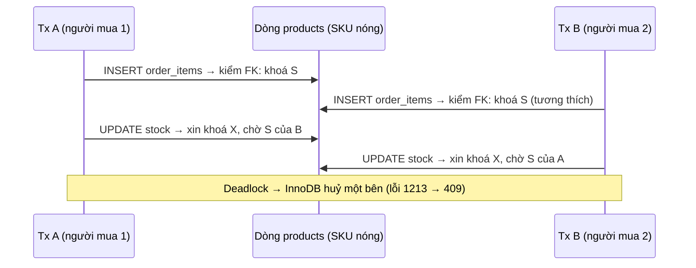

# ADR CONC-01: Trừ/hoàn kho bằng UPDATE nguyên tử, khoá dòng sản phẩm trước khi ghi đơn

**Trạng thái quyết định:** Chấp nhận vì tính đúng. **Không đạt mục tiêu hiệu năng:** Kaggle trên `a75256d` vẫn ~43–49 đơn/s (mục 5.4). Hướng tăng thông lượng chuyển sang phương án D/E.

## 1. Tóm tắt nhanh

- **Vấn đề giải quyết:** Nhiều người cùng đặt một SKU bị xếp hàng sau khoá bi quan `SELECT … FOR UPDATE`. TEST-00b đo được trần khoảng 48 đơn/s, p95 lên 4,3 s khi CPU còn rảnh.
- **Quyết định:** Trừ kho bằng `UPDATE … WHERE stock_quantity >= ?` (hoàn kho tương tự), kiểm tra số dòng bị ảnh hưởng, và **chạy UPDATE trước khi ghi `order_items`**. Huỷ đơn khoá dòng đơn bằng chính câu đọc.
- **Kết quả đo (CONC-01.5):** không còn deadlock, toàn vẹn OK, nhưng thông lượng 1 SKU nóng **không tăng** (42,7–48,5 so với 43,8–50 đơn/s). Trần nằm ở chi phí commit trong vùng khoá, không nằm ở cách khoá.
- **Bài học chính:** Một lần thử "ghi đơn trước, khoá kho sau" (CONC-01.3) gây deadlock hàng loạt trên MySQL, dù mọi test trên H2 đều pass. Số đơn/s tụt còn khoảng một nửa. Lần thử đó đã được revert, và thứ tự khoá được ghim bằng test.

## 2. Mục tiêu & Phạm vi

### Mục tiêu
- [x] Có lưới an toàn trước khi sửa: test N luồng cùng mua 1 SKU (CONC-01.1).
- [x] Bỏ `FOR UPDATE` khỏi `OrderService.create`, trừ kho nguyên tử (CONC-01.2).
- [x] ~~Rút ngắn vùng khoá bằng cách ghi đơn trước (CONC-01.3).~~ Đã thử, bác bỏ (mục 5.2).
- [x] Hoàn kho khi huỷ đơn bằng UPDATE nguyên tử (CONC-01.4).
- [x] So sánh trước/sau trên Kaggle với mốc 48 đơn/s (CONC-01.5): không cải thiện (mục 5.4).

### Ngoài phạm vi
- Chỉnh kho của admin (`ProductService`, `InventoryService`) vẫn dùng `FOR UPDATE`. Đây là đường ít tải; hai cơ chế khoá chạy đúng cùng nhau.
- Idempotency-Key cho `POST /api/orders` (CONC-03, Hiếu).
- Bỏ `refresh` và ghi movements theo lô (PERF-06).

## 3. Bối cảnh & Vấn đề kiến trúc

### 3.1. Hiện trạng (AS-IS, commit `462fecf`)
- `OrderService.create` khoá dòng `products` bằng `findAllByIdsForUpdate`, rồi trong cùng transaction: kiểm tồn, `saveAll` entity, ghi `orders`/`order_items` (có `flush` + `refresh`), ghi `inventory_movements`. Khoá giữ đến lúc commit.
- Minh chứng [`performance/results/20261121T153809Z`](../performance/results/20261121T153809Z/REPORT.md): 10→200 user cùng mua 1 SKU chỉ đạt **43,8–50 đơn/s**, p95 **290 ms → 4,3 s**, CPU chỉ 22–39%. Đây là nghẽn do khoá, không phải do thiếu tài nguyên.

### 3.2. Thuộc tính chất lượng

| Thuộc tính | AS-IS | Mục tiêu |
| :--- | :--- | :--- |
| **Performance** (1 SKU nóng, 200 user) | ~48 đơn/s, p95 4,3 s | Tăng đơn/s rõ rệt; con số cụ thể chốt ở SLO (TEST-00b.5) |
| **Data integrity** | Không bán âm (oversell 300/300) | Giữ nguyên: không bán âm, không mất cập nhật, log tồn kho khớp |
| **Reliability** | 0 deadlock | Không tạo thêm lỗi 409/500 do khoá |

Kịch bản thuộc tính chất lượng (theo cách viết của Bass et al.):

| Phần | Nội dung |
| :--- | :--- |
| Nguồn | 10–200 khách hàng đồng thời |
| Kích thích | `POST /api/orders` cùng 1 SKU, quantity 1, không think time |
| Môi trường | Tải cao; Kaggle CPU 4 luồng; API + MySQL 8.0 cùng máy |
| Artifact | `OrderService.create`, bảng `products` / `order_items` / `inventory_movements` |
| Phản hồi | Đơn được tạo hoặc trả 409 hết hàng; tồn kho không âm |
| Thước đo | Đơn/s, p95, tỉ lệ lỗi, số deadlock, toàn vẹn tồn kho = OK |

## 4. Quyết định & phương án

### 4.1. Phương án đã cân nhắc

| # | Phương án | Ưu | Nhược / đánh đổi | Kết luận |
| :--- | :--- | :--- | :--- | :--- |
| A | Giữ `SELECT … FOR UPDATE` | Đơn giản, đúng | Trần ~48 đơn/s, vùng khoá dài | Bỏ |
| B | Khoá lạc quan (`@Version`, thử lại khi xung đột) | Không giữ khoá lâu | SKU nóng thì hầu hết lượt bị xung đột → thử lại dồn dập | Bỏ cho SKU nóng |
| **C** | **UPDATE nguyên tử có điều kiện, UPDATE trước khi ghi đơn** | Một câu SQL vừa kiểm vừa trừ; không đọc–sửa–ghi; API không đổi | Khoá vẫn giữ tới commit (bao cả bước ghi đơn) | **Chọn** |
| C' | Như C nhưng ghi đơn trước rồi mới UPDATE (CONC-01.3) | Vùng khoá tường minh ngắn hơn | **Deadlock trên InnoDB** (mục 5.2) | Thử, bác bỏ |
| D | Chia tồn kho SKU nóng thành N phần (partition the quota) | Tăng song song, API giữ nguyên | Logic kho phức tạp, tổng tồn = tổng các phần | Dự phòng nếu C chưa đạt SLO |
| E | Hàng đợi đặt hàng (Queue-Based Load Leveling) | San tải đột biến, bảo vệ DB | Đổi API sang bất đồng bộ (202 + đơn chờ), cần idempotent consumer | Dự phòng, đụng nhiều nhất |

### 4.2. Quyết định (C)

```sql
-- Đặt hàng (theo product id tăng dần)
UPDATE products SET stock_quantity = stock_quantity - :q, version = version + 1, updated_at = current_timestamp
 WHERE id = :id AND status = 'ACTIVE' AND stock_quantity >= :q;   -- 0 dòng → 409 hết hàng
-- Huỷ đơn
UPDATE products SET stock_quantity = stock_quantity + :q, version = version + 1, updated_at = current_timestamp
 WHERE id = :id AND stock_quantity <= 2147483647 - :q;            -- 0 dòng → 409 (không tồn tại/tràn số)
```

Luồng `create` sau quyết định:

1. Đọc user và sản phẩm **không khoá**; kiểm tra sơ bộ (404/409 sớm).
2. Với từng sản phẩm theo id tăng dần: `UPDATE` trừ kho (lấy khoá X), đọc lại tồn để có `stock_after`.
3. Ghi `orders` + `order_items`. Kiểm khoá ngoại tới `products` lúc này không phải chờ, vì transaction đã giữ khoá X.
4. Ghi `inventory_movements` với `stock_before = after + q`, `stock_after = after`. Commit.

Huỷ đơn: `findByIdForUpdate` khoá dòng `orders` ngay trong câu đọc (mục 5.3), rồi hoàn kho bằng UPDATE nguyên tử và ghi `SALE_REVERSAL`.

Cột `version` vẫn tăng trong câu UPDATE, nên admin sửa sản phẩm cùng lúc vẫn bị khoá lạc quan phát hiện. Entity sản phẩm không còn được `saveAll` trong luồng đặt/huỷ, tránh `ObjectOptimisticLockingFailureException`.

### 4.3. Đánh đổi chấp nhận
- Khoá dòng sản phẩm vẫn giữ tới commit và bao cả bước ghi đơn. Muốn rút ngắn thêm thì làm PERF-06 (bỏ `refresh`, ghi movements theo lô), **không** được đảo thứ tự ghi.
- Giá trong đơn lấy từ lần đọc không khoá. Nếu admin đổi giá đúng lúc đó, đơn có thể mang giá trước đó vài mili giây.
- Sản phẩm bị ngừng bán giữa lúc đọc và lúc UPDATE thì trả 409 thay vì 404.

## 5. Kết quả & Kiểm chứng

### 5.1. Fitness functions đã thêm

| Loại | Kiểm tra | Nơi |
| :--- | :--- | :--- |
| Atomic, H2 | 32 luồng × 5 đơn, tồn 1000: bán đúng 160, các `stock_before` đôi một khác nhau (1000…841) | `OrderHotspotConcurrencyTest` |
| Atomic, H2 | 50 người tranh 20 món: đúng 20 đơn, tồn 0, không âm (lặp 3 lần) | như trên |
| Atomic, H2 | 40 đơn × 2 lệnh huỷ đồng thời + 30 người mua mới: 40 huỷ thành công, 40 nhận 409, chuỗi movements liền mạch | như trên |
| Atomic, unit | `decreaseStock` theo id tăng dần **trước** `orders.save` | `OrderServiceTest` |
| Holistic, MySQL | Kịch bản hotspot 5 pha trên Kaggle | `performance/kaggle_run.py` |

Kiểm tra ngược (trên code gốc, lúc viết CONC-01.1): tạm bỏ `@Lock(PESSIMISTIC_WRITE)` thì test hotspot fail cả 4 lượt. `mvn verify` pass ở `a75256d`: 142 test + 2 IT.

### 5.2. CONC-01.3 bị bác: deadlock do khoá ngoại

Kaggle [`20261122T090451Z`](../performance/results/20261122T090451Z/REPORT.md) trên `58af98f` (ghi đơn trước, UPDATE sau):

| Pha | Đơn/s trước (`462fecf`) | Đơn/s CONC-01.3 (`58af98f`) | Lỗi 409 | Deadlock InnoDB |
| :--- | ---: | ---: | ---: | ---: |
| hotspot_10 | 43,8 | 21,0 | 82% | 5.827 |
| hotspot_50 | 48,4 | 24,8 | 88% | 10.581 |
| hotspot_100 | 49,5 | 26,2 | 88% | 17.583 |
| hotspot_200 | 50,0 | 24,5 | 88% | 16.608 |

(Đơn/s = số đơn trong DB ÷ thời gian pha. p95 lần này thấp hơn, 160–1.300 ms, chỉ vì phần lớn request bị huỷ sớm. Toàn vẹn tồn kho vẫn OK cả 5 pha, oversell bán đúng 300/300.)

Nguyên nhân, đã tái hiện bằng 2 phiên trên MySQL 8.4:



Khi `UPDATE` chạy trước, transaction đã giữ khoá X, nên việc kiểm khoá ngoại về sau không phải xin thêm khoá. Hai phiên cùng commit.

H2 không đặt khoá S khi kiểm khoá ngoại, nên các fitness function trên H2 không thấy được lỗi này. Đã revert ở `a75256d` và ghim thứ tự trong `OrderServiceTest`.

### 5.3. Lỗi có sẵn được phát hiện: huỷ đơn hai lần

`findByIdForUpdate` dùng `select distinct … left join fetch items`. Trên H2, Hibernate chạy câu này thành một lần đọc **không khoá** rồi mới khoá bằng câu `select id … for update` riêng. Hai lệnh huỷ đồng thời đều thấy PENDING và cùng hoàn kho; lần thứ hai chỉ bị chặn bởi UNIQUE `reference_code`, nên trả 500. Lỗi có từ trước CONC-01 (đã kiểm trên `890862d`). Sửa ở `58af98f`: bỏ `join fetch` để câu đọc chính là `FOR UPDATE`, items nạp lazy trong cùng transaction.

### 5.4. Kết quả CONC-01.5: không tăng thông lượng

Kaggle [`20261122T104048Z`](../performance/results/20261122T104048Z/REPORT.md) trên `a75256d`, so với mốc [`20261121T153809Z`](../performance/results/20261121T153809Z/REPORT.md) (bảng đầy đủ ở `performance/REPORT.md`, PHẦN 4):

| Pha | Trước `FOR UPDATE` | Sau UPDATE nguyên tử | p95 trước → sau | Thời gian khoá InnoDB (ms) trước → sau |
| :--- | ---: | ---: | :--- | :--- |
| hotspot_10 | 43,8 đơn/s | 42,7 đơn/s | 290 → 290 ms | 510.465 → 505.917 |
| hotspot_50 | 48,4 | 43,1 | 1.100 → 1.400 ms | 531.415 → 528.959 |
| hotspot_100 | 49,5 | 46,9 | 2.300 → 2.300 ms | 813.006 → 812.497 |
| hotspot_200 | 50,0 | 48,5 | 4.300 → 4.500 ms | 831.648 → 828.958 |

0 deadlock, 0 lỗi, toàn vẹn tồn kho OK cả 5 pha, oversell bán đúng 300/300. Mỗi bên chỉ 1 lượt đo nên mức lệch −3% đến −11% chưa đủ để nói là tệ hơn, nhưng rõ ràng là không cải thiện.

**Vì sao:** khoá dòng chỉ nhả sau commit. Với cấu hình MySQL mặc định (`innodb_flush_log_at_trx_commit=1`, `sync_binlog=1`), mỗi commit chờ ghi đĩa, nên các đơn cùng SKU xếp hàng qua từng lần fsync. Đổi `FOR UPDATE` sang `UPDATE`, hay đảo thứ tự các câu bên trong, đều không làm vùng khoá ngắn hơn phần commit đó. Đo vi mô trên MySQL 8.4 bằng Docker ở máy dev, chuỗi `UPDATE` dòng nóng + `INSERT` + `COMMIT` tuần tự: **8,9 ms/tx** với fsync mỗi commit, **0,16 ms/tx** khi tắt. Trên Kaggle, ~21 ms/đơn khớp với giả thuyết này, nhưng chưa đo trực tiếp vì runner không ghi các biến độ bền vào metadata.

**Hệ quả cho quyết định:** giữ C vì tính đúng (bỏ đọc–sửa–ghi entity, thứ tự khoá chống deadlock khoá ngoại) và vì C là nền cho D (mỗi phần tồn kho vẫn trừ bằng UPDATE có điều kiện). Mục tiêu hiệu năng của CONC-01 chưa đạt bằng thay đổi cấp câu lệnh SQL. Theo Bass, đây là lúc chuyển từ *control resource demand* sang *manage resources*: *introduce concurrency* (D) hoặc *schedule resources / bound queue* kèm gom lô (E).

## 6. Khó khăn & Rủi ro

- [x] **Test H2 cho cảm giác an toàn giả** với hành vi khoá của InnoDB.
  - *Giải pháp:* ghim thứ tự bằng unit test; đối chiếu bằng Kaggle MySQL trước khi chốt.
- [ ] **Chưa có fitness function MySQL chạy được trên máy dev / CI** (máy dev không có `.env` cho compose; dự án chưa dùng Testcontainers).
  - *Mức độ:* Trung bình. Mỗi lần đổi thứ tự khoá đều phải đợi một lượt Kaggle mới biết.
- [ ] **Deadlock là lỗi tạm thời, hiện trả thẳng 409.** Có thể thử lại 1–2 lần có backoff, nhưng chỉ an toàn khi đã có idempotency (CONC-03).
  - *Mức độ:* Thấp với phương án C (lý thuyết không còn chu trình khoá trên 1 SKU).

## 7. Kế hoạch tiếp theo

- [x] Chạy hotspot trên Kaggle với `a75256d`, ghi bảng trước/sau vào `performance/REPORT.md` (Sơn, xong `2026-11-22`).
- [ ] Chốt SLO hotspot với nhóm (TEST-00b.5). Nếu SLO > ~50 đơn/s cho 1 SKU thì phải làm D hoặc E (Sơn + nhóm, `2026-11-29`).
- [ ] Runner ghi `innodb_flush_log_at_trx_commit`, `sync_binlog`, `log_bin` vào `metadata.json`; có thể thêm một lượt chẩn đoán với độ bền nới lỏng để kiểm chứng giả thuyết fsync trên Kaggle. Chỉ để chẩn đoán, không dùng làm số "sau cải tiến" (Sơn).
- [ ] PERF-06 (bỏ `refresh`, ghi movements theo lô): giảm vài câu trong vùng khoá, nhưng theo mục 5.4 **khó tăng thông lượng 1 SKU** vì phần commit vẫn còn. Cần đo lại trước khi kỳ vọng (Sơn, `2026-12-06`).
- [ ] Script kiểm tra deadlock 2 phiên trên MySQL bằng Docker làm fitness function cục bộ (Sơn).

## 8. Tài liệu tham khảo

1. Mark Richards, Neal Ford, *Fundamentals of Software Architecture*, O'Reilly, 2020: đánh đổi ("First Law"), fitness functions, Architecture Decision Records.
2. Microsoft, *Azure Architecture Center*:
   [Minimize coordination](https://learn.microsoft.com/en-us/azure/architecture/guide/design-principles/minimize-coordination) (tranh khoá khi mở rộng, khoá lạc quan, chia dữ liệu và chia hạn mức),
   [Retry pattern](https://learn.microsoft.com/en-us/azure/architecture/patterns/retry) (lỗi tạm thời, idempotency, retry không thay việc sửa giới hạn mở rộng),
   [Queue-Based Load Leveling](https://learn.microsoft.com/en-us/azure/architecture/patterns/queue-based-load-leveling) (không hợp khi bên gọi cần phản hồi đồng bộ).
3. Microsoft, *Microsoft Application Architecture Guide*, 2nd Edition: hướng dẫn tầng dữ liệu về concurrency/transaction (transaction ngắn, chọn mô hình khoá, truy cập tài nguyên theo cùng thứ tự).
4. Len Bass et al., *Software Architecture in Practice*, 4th Edition: kịch bản thuộc tính chất lượng, performance tactics (control resource demand / manage resources).
5. Minh chứng: [`performance/results/20261121T153809Z`](../performance/results/20261121T153809Z/REPORT.md) (trước), [`performance/results/20261122T090451Z`](../performance/results/20261122T090451Z/REPORT.md) (CONC-01.3, bị bác), [`performance/results/20261122T104048Z`](../performance/results/20261122T104048Z/REPORT.md) (sau, `a75256d`).
6. MySQL 8.0 Reference Manual, *InnoDB Locking* và *Locks Set by Different SQL Statements in InnoDB* (khoá S khi kiểm khoá ngoại).
