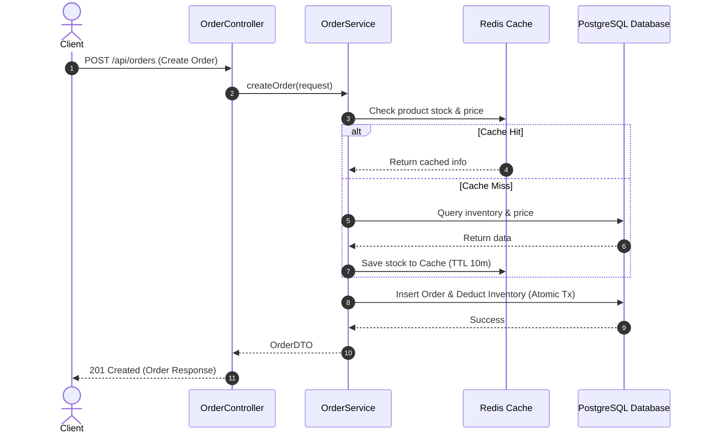

# [Tiêu đề công việc]: [Mô tả ngắn gọn kết quả chính]

## 1. 📌 Tóm tắt nhanh (Executive Summary)
<!--
Viết 2-4 câu tóm tắt cốt lõi: Bạn đã giải quyết vấn đề gì? Đạt được kết quả gì? Ảnh hưởng thế nào đến kiến trúc hoặc hiệu năng của hệ thống?
-->
- **Vấn đề giải quyết:** 
- **Kết quả đạt được:** 
- **Tác động chính:** 

---

## 2. 🎯 Mục tiêu & Phạm vi (Objectives & Scope)

### Mục tiêu cụ thể:
- [ ] Mục tiêu 1 (Ví dụ: Đánh giá độ trễ của API tạo đơn hàng dưới tải 500 RPS).
- [ ] Mục tiêu 2 (Ví dụ: Đề xuất phương án áp dụng Cache-Aside Pattern với Redis).
- [ ] Mục tiêu 3 (Ví dụ: Tái cấu trúc lớp OrderService để giảm Coupling với Inventory).

### Ngoài phạm vi (Out of Scope):
- Những vấn đề không nằm trong phiên làm việc này hoặc dời sang giai đoạn sau.

---

## 3. 🔍 Bối cảnh & Vấn đề kiến trúc (Architectural Context & Problem Statement)

### 3.1. Hiện trạng hệ thống (AS-IS):
<!--
Mô tả hiện trạng của module/chức năng đang phân tích. Đính kèm trích dẫn file code hoặc cấu trúc database hiện tại.
Ví dụ: Tại StoreService.java, truy vấn database đang bị N+1 khi duyệt danh sách sản phẩm trong giỏ hàng.
-->
- **Module liên quan:** `src/main/java/com/...`
- **Hiện tượng / Khuyết tật kiến trúc (Architectural Smells / Bottlenecks):**
  - Vấn đề 1: ...
  - Vấn đề 2: ...

### 3.2. Đánh giá chất lượng theo thuộc tính kiến trúc (Quality Attributes / Non-Functional Requirements):
| Thuộc tính (Attribute) | Hiện trạng (AS-IS) | Kỳ vọng mục tiêu (TO-BE) |
| :--- | :--- | :--- |
| **Performance (Latency/RPS)** | P95 = 1200ms, max 80 RPS | P95 < 200ms, tải 300+ RPS |
| **Maintainability (Coupling)** | High coupling giữa Order & Inventory | Loose coupling qua Event hoặc DTO rõ ràng |
| **Scalability** | Single instance, session in-memory | Stateless service, distributed cache |
| **Reliability** | Thất bại dây chuyền khi DB quá tải | Thêm Circuit Breaker / Retry logic |

---

## 4. 🛠️ Chi tiết công việc đã thực hiện (Detailed Work Done)

### 4.1. Phân tích & Đề xuất giải pháp (Design Decisions):
<!--
Giải thích lý do lựa chọn giải pháp này thay vì các giải pháp thay thế khác (Trade-off Analysis).
-->
- **Giải pháp lựa chọn:** 
- **Lý do lựa chọn (Pros):** 
- **Đánh đổi chấp nhận (Cons/Trade-offs):** 

### 4.2. Sơ đồ kiến trúc / Luồng dữ liệu (Architecture / Flow Diagram):
<!--
Vẽ sơ đồ bằng Mermaid để cả Human và AI đều render/hiểu được.
-->


### 4.3. Thay đổi mã nguồn / Cấu hình chính (Key Implementation Details):
- **Files thay đổi:**
  - `src/main/java/.../OrderService.java`: ...
  - `compose.yaml`: ...
  - `src/main/resources/application.properties`: ...

#### Trích đoạn mã nguồn quan trọng (Code Snippet):
```java
// Minh họa thay đổi hoặc đoạn code cốt lõi
```

---

## 5. 📊 Kết quả & Kiểm chứng (Results & Verification)

### 5.1. So sánh số liệu Trước & Sau (Before vs After Comparison):
| Chỉ số (Metric) | Trước cải tiến (Before) | Sau cải tiến (After) | Cải thiện (%) |
| :--- | :--- | :--- | :--- |
| **Throughput (RPS)** | ... | ... | +...% |
| **P95 Latency (ms)** | ... | ... | -...% |
| **Database Connection Pool Usage** | ... | ... | ... |
| **Memory / CPU Footprint** | ... | ... | ... |

### 5.2. Bằng chứng thực nghiệm (Logs / Screenshots / Test Results):
<!--
Dán log test, kết quả curl, kết quả chạy JMeter/k6 hoặc log chạy test thành công.
-->
```text
[INFO] Tests run: 12, Failures: 0, Errors: 0, Skipped: 0, Time elapsed: 4.234 s
```

---

## 6. 🚧 Khó khăn, Thách thức & Rào cản (Blockers & Challenges)

- [x] **Vấn đề đã xử lý:** ...
  - *Giải pháp:* ...
- [ ] **Vấn đề còn tồn đọng (Active Blockers):** ...
  - *Mức độ nghiêm trọng:* `Cao | Trung bình | Thấp`
  - *Cần sự hỗ trợ từ:* [Tên thành viên / Giảng viên]

---

## 7. ⏭️ Kế hoạch tiếp theo (Next Steps)

- [ ] Công việc 1: ... (Người phụ trách: ..., Thời hạn: `YYYY-MM-DD`)
- [ ] Công việc 2: ... (Người phụ trách: ..., Thời hạn: `YYYY-MM-DD`)

---

## 8. 📚 Tài liệu tham khảo & Phụ lục (References & Artifacts)

1. [Đặc tả bài toán Phase 2](https://docs.google.com/document/d/1xJSMMyIZH-bQcznc303Pgg2bISfpnnQMS04c3AmLzeQ/edit)
2. Mã nguồn liên quan: Commit `hash` trên branch `branch-name`.
3. Tài liệu kiến trúc tham khảo: [Pattern name / Martin Fowler article / Spring doc].
